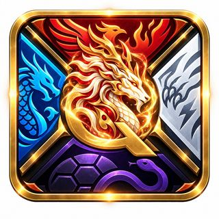
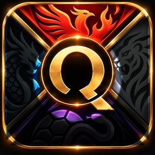
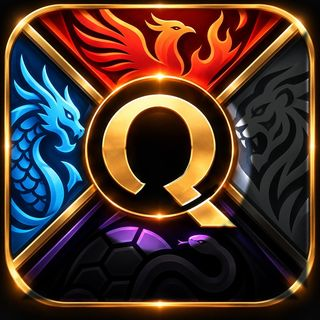
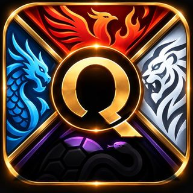
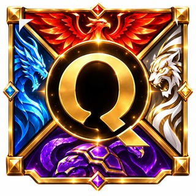
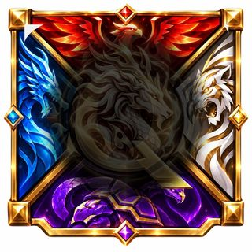
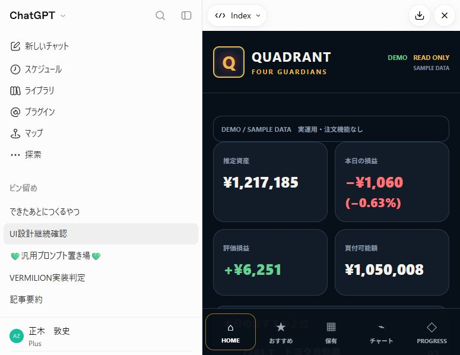
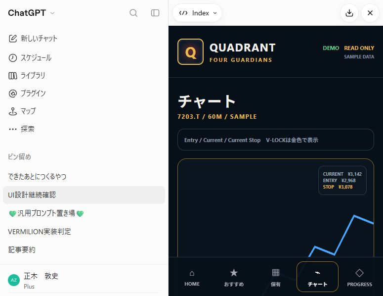

# Q UI ビジュアル成果物

## 核となる4+1：四神獣＋中央の金色麒麟

[原画像 stage6.jpg](design_assets/stage6.jpg) — q_assets_exact.zipから回収した既存画像。

## 進行段階6枚

|1|2|3|
|---|---|---|
||||
|4：四神獣＋Q|5：中央麒麟の移行段階|6：金色麒麟|
||||

## UI・トレールの完成像

[修正版UIの表示HTML](design_reference/corrected_index_rendered.html) — 10月1日07:14添付をブラウザーで開き、表示DOMを回収。元ダウンロードファイルとのbyte一致は未証明。デザイン参照用のサンプル表示であり、本番稼働証明ではない。

[V-LOCKチャートのSVG](design_reference/corrected_ui_v_lock_chart.svg)

[画面構成、金縁カード、トレール、V、Market Briefの詳細仕様](RECOVERED_UI_SPEC.md)

[既存Q保有画面の会話ビューアー記録](design_reference/existing_q_positions_capture.jpg)

## 回収したHTMLの履歴

- [POSITIONS・詳細・CHART・V-LOCKの検討画面](design_reference/quadrant_showcase.html)
- [上記の生成元Python](design_reference/quadrant_showcase.py)
- [モバイル検討案](design_reference/QUADRANT_Q_MOBILE_DEMO.html)

これらの旧DEMO案は最終承認UIではない。モバイル案の英語ナビは拒否され、上の修正版でQの既存日本語UIと金縁カードに戻された。独立したVロゴ原画像は未回収。上のV画像は回収した修正版チャートの表示記録とSVGであり、独立Vロゴの代替原本とは称しない。
